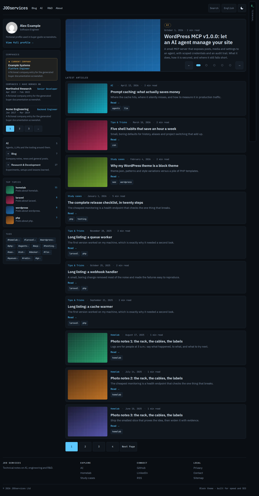

# Getting started

## Before you install

- WordPress 6.6 or newer and PHP 8.1 or newer.
- A working WordPress administrator account and a current backup if this site already has content.
- The JOOservices theme ZIP and the separate JOOservices Resume plugin ZIP from the ThemeForest release package. The theme still renders posts without the plugin, but profile and company features need it.

## Install and activate

1. In WordPress, open **Appearance → Themes → Add New Theme → Upload Theme** and upload the `jooservices-<version>.zip` file. Select **Install Now**, then **Activate**.
2. Open **Plugins → Add New Plugin → Upload Plugin**. Upload the `jooservices-resume-<version>.zip` file, select **Install Now**, then **Activate Plugin**.
3. Visit the site once. The theme includes five colour schemes; use the header control to cycle through them.
4. Open **Appearance → Editor → Navigation**. Create the menu links you need and assign the menu to the theme's primary navigation area. Save the changes.
5. Open **Users → Profile** and add a display name, title, short biography, avatar, and social links. See [Profile and company history](resume-and-company.md).
6. Add a post with a category and featured image. Publish it, then open the homepage and the post to confirm the layout.
7. Add an About page and select the **Full width** template in the page editor. Add company history using the Resume plugin's Companies screen.

## Import demo content

The current installable theme does not contain a buyer-facing demo importer or downloadable import package. The repository's `make demo` and generated WXR data are developer showcase tools; they are not included in a buyer ZIP. Do not use a developer demo export as sale content. A licence-clean ThemeForest import package and first-time buyer dry run remain release requirements.

Until that package is available, the steps above create a working site with your own content. They do not recreate the populated showcase in under 15 minutes.

## Screenshots

The guide's screenshots come from the showcase, not hand-edited captures. From a prepared showcase site, regenerate them with:

```sh
make screenshots THEME=jooservices ARGS="--output docs/buyer/assets --views home,about --viewports desktop --schemes dark"
```

The screenshot runner writes `home-desktop-dark.png` and `about-desktop-dark.png`. CI checks the generated references and local links; it does not fabricate or refresh screenshots without a running showcase.



The supported browser list is in the [buyer guide release notes](README.md#release-notes-for-buyers).
