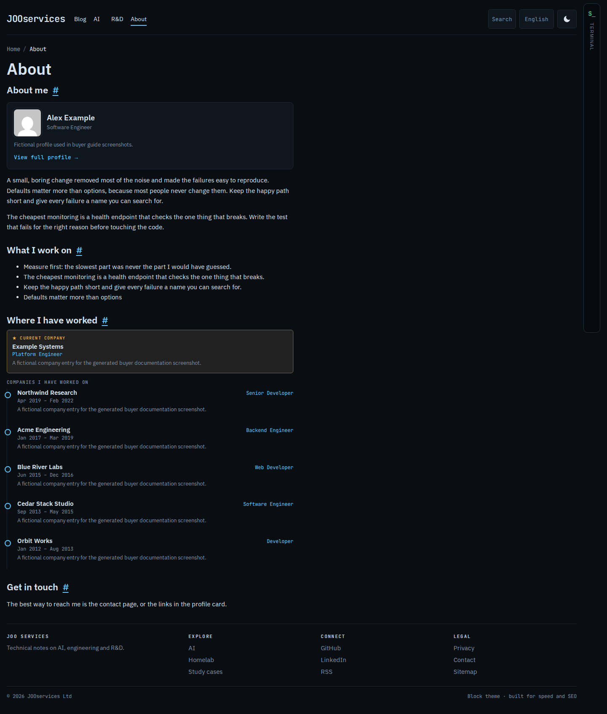

# Profile and company history

The JOOservices Resume plugin (`jooservices-resume`) provides the Company content type and profile, topic, and featured-post fields. Install and activate it alongside the theme before entering resume information. Existing WordPress posts remain available if the plugin is deactivated.

## Set up your profile

1. Open **Users → Profile** for the account used as the site author.
2. Set the public display name, title, short biography, and social links. The optional avatar field accepts a Media Library attachment ID; leave it blank if you do not have the ID.
3. Save, then check a post and the About page. The theme uses this information in the profile card and author box.

## Add a company

1. In the dashboard, open **Companies → Add New**.
2. Enter the employer as the title and add a short description of the role and work in the content editor.
3. In the company details, set the role and start month. Set an end month for a previous role; leave it empty for a current role.
4. Add the company website URL if you have one. The optional logo field accepts a Media Library attachment ID; leave it blank if you do not have the ID. Use only a logo you own or have permission to publish.
5. Mark the current company as **Pinned** if it should appear first. Keep at most one company pinned.
6. Publish and open the About page. The company timeline and profile card use the saved Resume data.

The screenshot is generated from the populated showcase. Your page will show the profile and companies you enter.

## Make the About page

Create or edit the About page and choose the **Full width** template. Add your introduction and any core WordPress blocks you need. The theme's company display uses Resume records; keep company details in the Companies screen so they can be reused by the profile and resume views.

## Featured posts

Edit a post and use the **Featured** controls to enable it and set its order. The first five featured posts can appear in the homepage slider. Add a featured image at least 900 pixels wide and preview the page on a phone before publishing.

## If the plugin is unavailable

The theme remains usable for ordinary posts and pages. Resume blocks that require company or profile data hide when there is no data provider. Install and activate `jooservices-resume` to use the resume features; the theme ZIP does not include the plugin.
