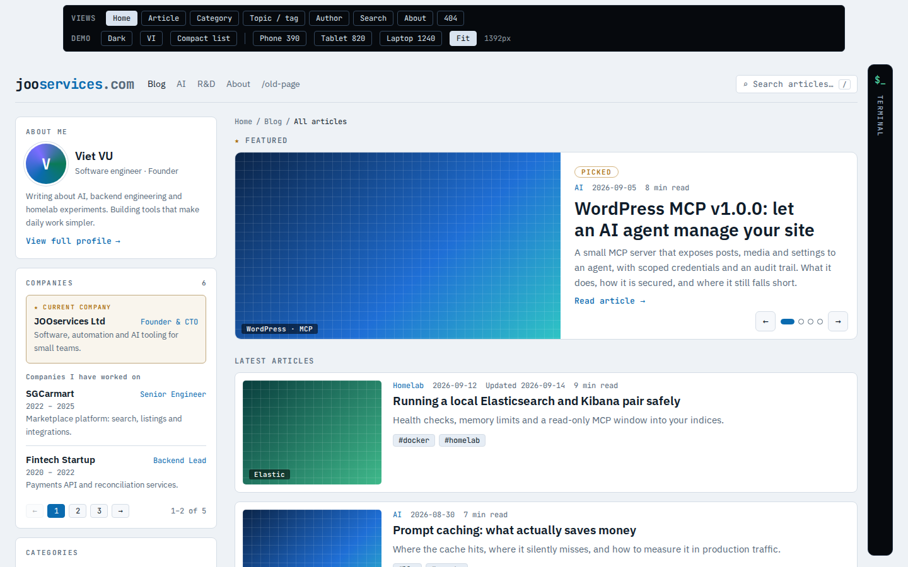
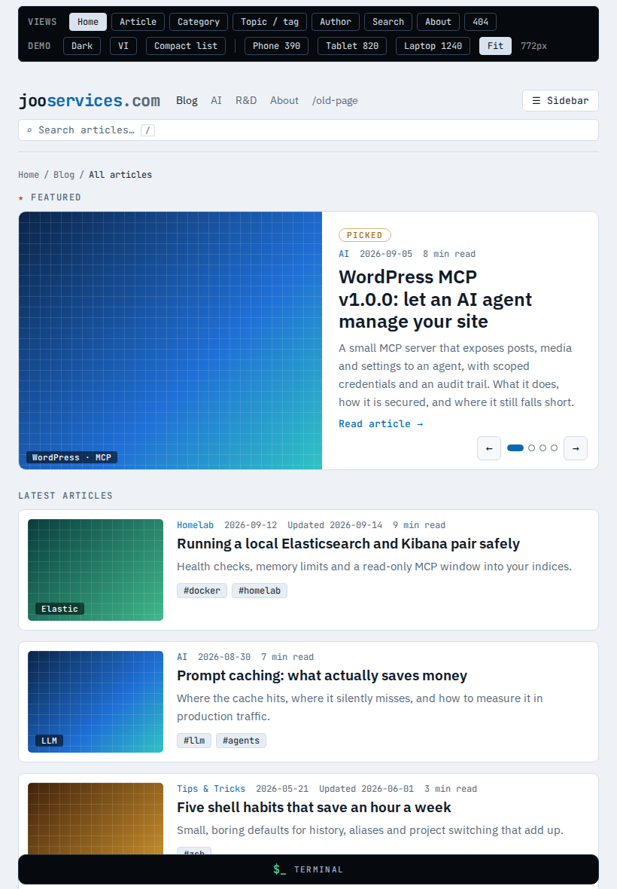
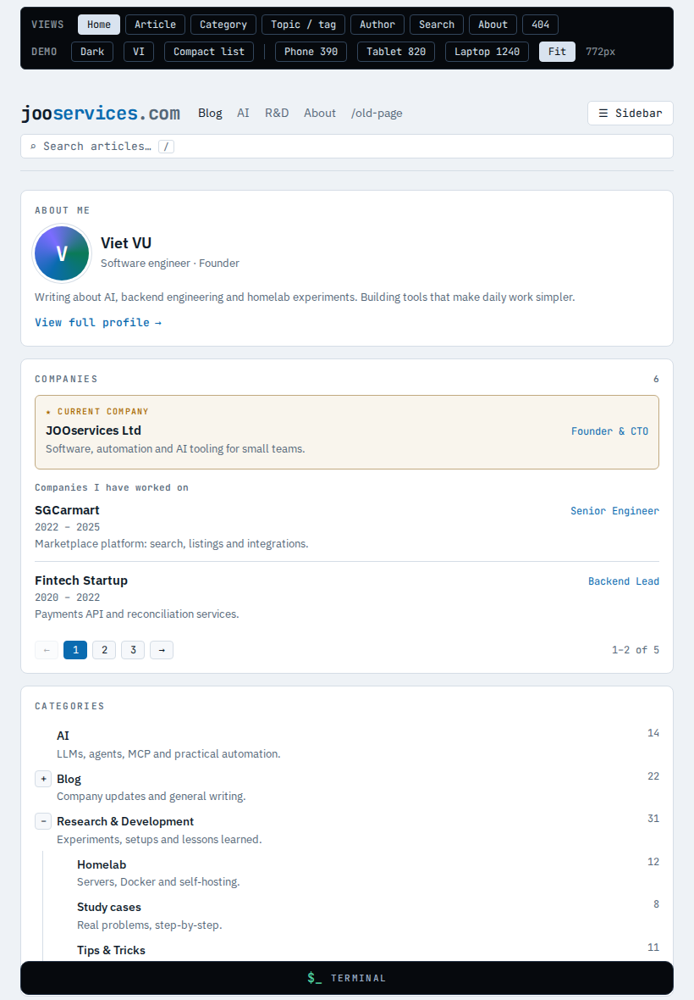
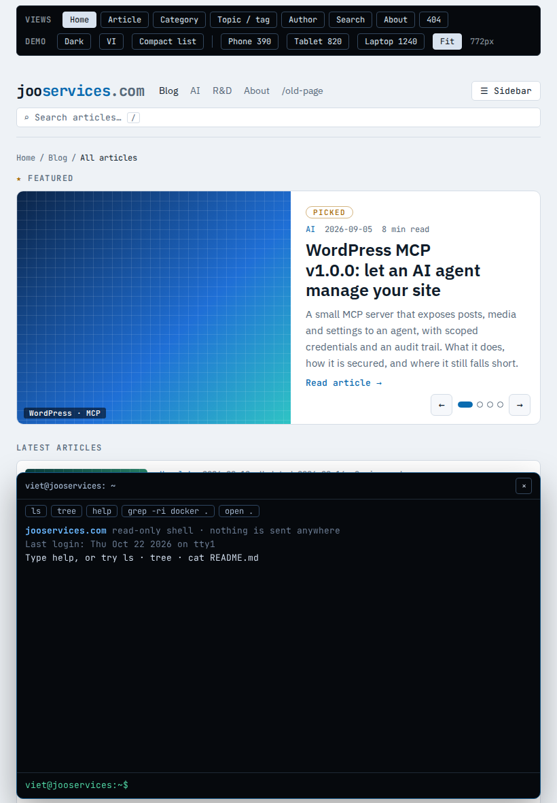
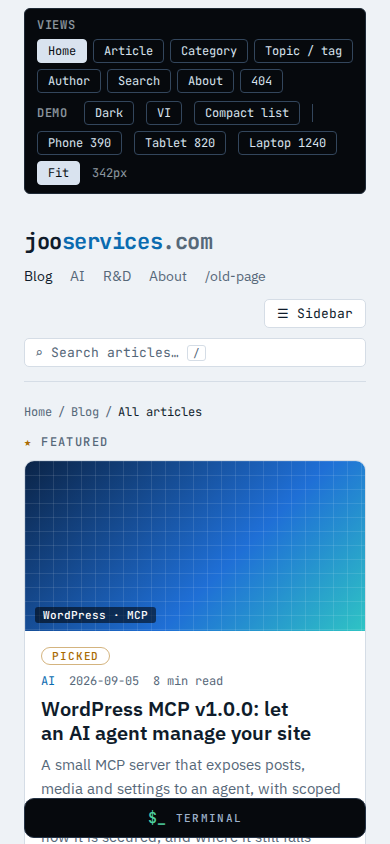
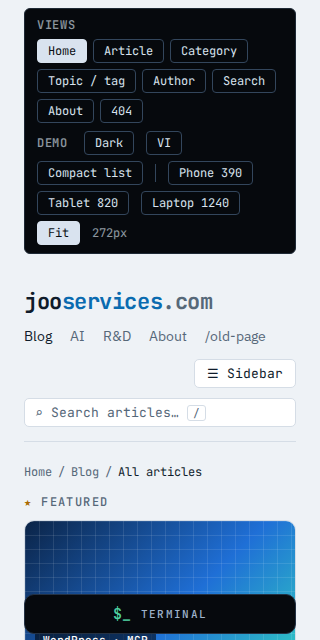

# JOOservices theme responsive behaviour

This document describes the responsive rules shipped by `themes/jooservices`. The shell and its content use container
queries so the rail and cards react to the space left after the terminal dock is laid out. The navigation overlay and
terminal dock use viewport breakpoints. Orientation does not select a separate layout; the same width rules apply after
rotation.

## Breakpoint behaviour

| Width condition | Behaviour |
| --- | --- |
| Viewport ≥1480px | The frame stops growing at 1480px and stays centered. The rail remains beside the main content; the terminal is a sticky 44px tab on the right and opens as a 390px dock. |
| Shell >1080px | The rail uses its 320px token width and the main column takes the remaining space. Cards retain their thumbnail and text columns. |
| Shell 901–1080px | The rail narrows to 280px and card thumbnails narrow to 180px. The rail stays beside the main column. |
| Shell ≤900px | The rail folds out of the page layout and is opened with the Sidebar button. Header tools wrap onto their own row. The footer switches to two columns. |
| Shell ≤640px | Post cards collapse to one column and thumbnails move above their text. The featured slide also collapses to one column. The footer copyright row stacks. |
| Viewport ≤600px | WordPress navigation switches to its responsive menu button and opens as a navigation overlay. The theme styles the open and close controls to 44px minimum targets. |
| Shell ≤420px | Banner padding tightens, carousel arrows are hidden while the 44px dots and pause control remain, company role rows stack, and the footer becomes one column. |
| Viewport ≤900px | The closed terminal is a full-width bar after the page. Opening it turns it into a bottom sheet limited to 62dvh or 480px, whichever is smaller. |
| Viewport >900px | The terminal stays in the right-hand column. Opening it takes 390px beside the shell so page content reflows instead of sitting underneath it. |

Container breakpoints refer to `.joo-shell` width; viewport breakpoints refer to `window.innerWidth`. At 400% browser zoom,
the effective CSS viewport becomes narrow, so the same rail fold, dock sheet, navigation overlay and card collapse rules
apply. Text-only zoom keeps the viewport width and increases text dimensions, allowing the text and controls to wrap.

## Responsive screenshots

These captures show the breakpoint states documented above. They are generated from the bundled responsive design
reference, which uses the same rail, card and dock breakpoints as the theme. Regenerate them with
`node themes/jooservices/tests/responsive-screenshots.mjs`; pass a running site URL to capture its rendered theme instead.

The [interactive design reference](../themes/jooservices/design/reference-demo.html) includes narrow and wide viewport
presets for the rail fold, dock sheet and card collapse. The automated browser suite checks those behaviours against the
rendered WordPress theme at every matrix viewport.

## Automated viewport matrix

`themes/jooservices/tests/e2e/responsive.spec.ts` discovers every `templates/*.html` file at runtime and checks each
template for document overflow, visible elements escaping the viewport, overflow-clipped containers, and visible
primary controls below 44×44 CSS pixels.

Chromium checks these widths at 900px height: 320, 360, 390, 430, 540, 768, 820, 1024, 1280, 1440, 1920, 2560 and 3840px.
It also checks portrait and landscape pairs 390×844 / 844×390, 820×1180 / 1180×820 and 1024×768 / 768×1024. The
`responsive-webkit` and `responsive-firefox` Playwright projects check 390×844, 820×1180 and 1440×900 whenever the
jooservices theme suite runs. The optional `E2E_ENGINES` setting continues to run the broader theme suite on those engines.

The `home.html` and `index.html` files are currently identical. WordPress selects `home.html` for the posts index while
`index.html` is the hierarchy fallback, so the test uses the home route for both file entries and asserts their source
remains identical. The two custom page templates and the default page template are exercised with temporary published
pages that are removed after the matrix run.

The 200% text-only check doubles each rendered text element's computed font size without changing viewport dimensions. It
runs for every template at 390px and at 320px. The 400% reflow check is its own step: after the matrix, every template is
loaded again in a 320×256 viewport (1280×1024 at 400% zoom) and checked for horizontal scroll, clipping, 44×44 targets and
the rail, card and dock rules.

## Manual device checklist result

Run these checks on real devices when they are available. During this ticket work, no physical iPhone or Android device was
available to the worktree session; the physical-device checks are recorded as not run rather than passed.

| Date | Device | Browser | Result |
| --- | --- | --- | --- |
| 2026-10-22 | Physical iPhone | Safari | Device unavailable; not run. |
| 2026-10-22 | Physical Android phone | Chrome | Device unavailable; not run. |

On each device, check the home page, a post and 404; open the rail, navigation overlay and terminal sheet; use the
on-screen keyboard in the terminal; change the colour theme; rotate the device; and pinch zoom. Check that the input stays
visible above the keyboard and that no page content is cut off or scrolls horizontally.
