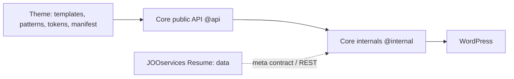
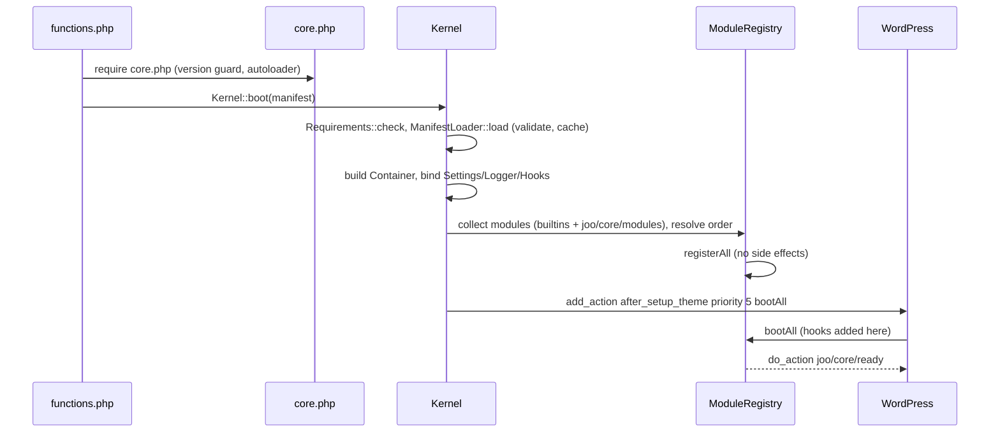

# JOOservices theme core: specification v0.1

Status: frozen for implementation (spec tag `spec-0.1`). Changes after this point need an ADR amendment. Machine-readable parts: `packages/theme-core/schema/*.json`, `docs/spec/naming-registry.json`.

## 1. Goals and non-goals
Goals: one reusable engine so a theme supplies only presentation (templates, patterns, tokens, manifest); SEO, performance, lazy loading, settings, plugin compatibility, blocks and terminal are provided once. Non-goals: classic (non-block) themes, page-builder design, storefront design, shipping SEO as a separate plugin in v1 (an ADR can revisit).

## 2. Layering and dependency rule

Rule (deptrac): `ThemeCore\*` depends on WordPress and `ThemeCore\*` only; themes (PHP in `inc/`) depend on core and WordPress only; the plugin depends on WordPress only. Modules never call each other directly: they use declared `dependencies()`, the container, or filters.

## 3. Public API catalogue (`@api`)
| Symbol | Signature | Purpose |
|---|---|---|
| `Kernel::boot` | `boot(string $manifestPath, array $options = []): void` | Single entry from `functions.php`; idempotent |
| `Kernel::container` | `container(): ?Container` | Access to services after boot |
| `Settings` | `get(string $key, mixed $default = null): mixed`, `all(): array`, `source(string $key): string`, `schema(): array` | Effective settings (filters > saved > manifest > core default) |
| `Hooks` | `filter(string $hook, mixed $value, mixed ...$args): mixed`, `action(string $hook, mixed ...$args): void`, `deprecated(string $hook, string $since, string $replacement = ''): void` | Namespaced hook helpers (`joo/{module}/{event}`) |
| `Container` | `get(string $id)`, `has(string $id)`, `bind`, `singleton`, `instance`, `extend` | Services; replace via filter `joo/core/services` |
| `ModuleInterface` / `AbstractModule` | `static id(): string`, `dependencies(): array`, `register(Container $c): void`, `boot(): void` | Module contract |
| `Content\ContentProviderInterface` | `profile()`, `pinnedCompany()`, `companies($page,$perPage,$excludePinned)`, `categoryTree($hideEmpty)`, `topics($limit,$strategy)`, `featured($limit)`, `related($postId,$limit)` | Data for blocks, schema and terminal |
| `Seo\Schema\Piece` | `id(Context $c): string`, `isNeeded(Context $c): bool`, `generate(Context $c): array` | JSON-LD graph pieces |
| `Blocks\DynamicBlock` | `name(): string`, `data(array $attrs, \WP_Block $block): array`, `render(...)` | Server-rendered blocks with theme-overridable templates |
| `Terminal` JS `registerCommand` | `registerCommand({name, usage, summary, completion, run})` | Extra terminal commands |
Everything else is `@internal`.

## 4. Manifest v1
File `joo-theme.json` at the theme root, validated by `schema/manifest.schema.json` (examples in `docs/spec/examples/`). Keys: `schema`, `slug`, `name`, `core` (semver range), `modules`, `features`, `design`, `menus`, `imageSizes`, `images`, `seo`, `lazy`, `perf`, `compat`, `i18n`, `terminal`, `blocks`, `content`. Unknown top-level keys are rejected except `x-*`. The runtime validator supports only the schema keywords used (type, enum, required, properties, additionalProperties, patternProperties `^x-`, items, minimum, maximum, minLength, maxLength, minItems, pattern); a test fails if the schema uses any other keyword.

Theme-specific labels and examples stay in the manifest when they differ from core defaults: `blocks.categoryLabel`, `blocks.patternCategory` and `blocks.patternCategoryLabel` control editor categories; `blocks.notFoundPlaceholder` controls the retry example; `content.profilePagePath` optionally names the profile page; and `terminal.shortcuts` sets the terminal command chips. Without overrides, categories use `Theme Core`/`theme-core`, the retry example is `/example-path`, the profile card links to the author archive, and terminal chips are `ls`, `tree`, `help` and `find . -type f`.

## 5. Settings model
Single autoloaded option `joo_{slug}_settings` stores only values that differ from defaults. Effective value order: PHP filter `joo/settings/value` > saved option > manifest (mapped path in the descriptor) > core default from `schema/settings.schema.json`. `Settings::source($key)` returns `filter|user|manifest|core`. Sanitisers: `bool`, `int_range`, `enum`, `text`, `attachment_id`, `user_id`, `term_ids`, `string_list`. The admin page and the reference docs are generated from the descriptor.

## 6. Naming registry
See `docs/spec/naming-registry.json` (checked by `node tools/check-registry.mjs`; generated page `docs/reference/naming.md`). Prefixes: options/meta/transients `joo_`/`_joo_`, hooks `joo/{module}/{event}`, REST namespace `joo/v1`, blocks `joo/`, custom elements `joo-`, CSS `joo-`.

## 7. Boot sequence

Contexts: front-end modules add hooks on `wp_head`, `wp_enqueue_scripts`, `template_redirect`; REST routes on `rest_api_init`; admin pages on `admin_menu`.

## 8. Error model
Levels debug/info/warning/error. A module that throws in `register()` or `boot()` is caught, logged (error_log only when `WP_DEBUG_LOG` or setting `core.debug`), marked `failed`; its dependents are `blocked`; the front-end renders normally (HTTP 200); admins with `edit_theme_options` see an admin notice and Site Health entry. Invalid manifest or unsupported PHP/WP: notice, no module boots, front-end continues with plain WordPress.

## 9. Budgets
Boot: < 3 ms, < 1.5 MB peak for an empty module set. Frontend runtime JS <= 3 KiB gzip; slider <= 5 KiB; TOC <= 3 KiB; companies <= 2.5 KiB; tree <= 2 KiB; pure terminal engine <= 5 KiB and complete on-demand terminal bundle (engine, built-in commands and UI) <= 9 KiB gzip (ADR 0012). Critical CSS <= 14 KiB gzip per template. Current JavaScript measurements and exact byte limits are recorded in `docs/reference/budgets.md`. Page budgets and Lighthouse thresholds: `docs/definition-of-done.md` (G7).

## 10. Compatibility policy
Tiers 1 (automatically tested), 2 (compatible by standards), 3 (basic: page builders, WooCommerce). Yield modes for SEO: `auto|never|always`; lazy loading yields to other optimisers unless `lazy.yield_to_plugins` is false.

## 11. Versioning and deprecation
SemVer; theme manifest `core` range is checked at boot. Public API (`@api`, documented `joo/` hooks) is stable within a major; deprecations live one minor release with `Hooks::deprecated()`; BC check `tools/bc-check.sh`.

## 12. Later
Image sitemaps, `410` handling, server-side syntax highlighting, translation-plugin sync of term meta, redirect manager, `joo_series` taxonomy, Interactivity API re-evaluation, SEO as a standalone plugin.
